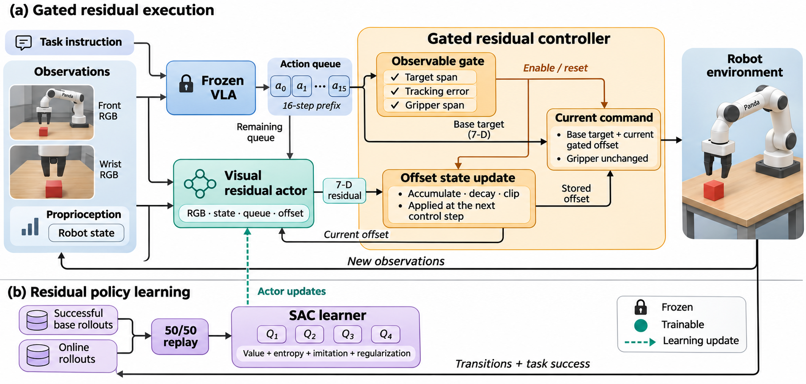
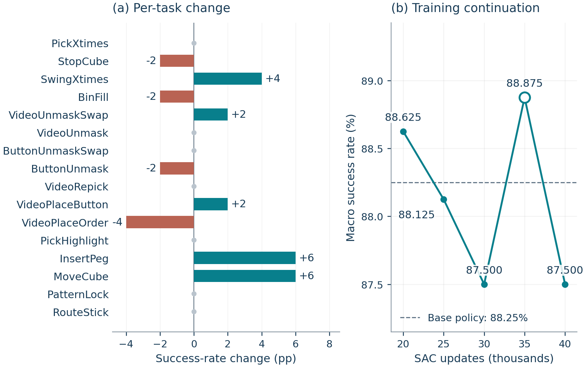

<div align="center">

<h1>GR-SAC</h1>
<h3>Gated Residual Reinforcement Learning<br>for Vision-Language-Action Models</h3>

<p>Learn local action corrections. Keep the pretrained VLA frozen.</p>

<p>
  <a href="https://github.com/zhudongwork/GR-SAC">GitHub</a> ·
  <a href="release/GR-SAC-Technical-Report.pdf">Technical Report</a> ·
  <a href="#overview">Overview</a> ·
  <a href="#method">Method</a> ·
  <a href="#results">Results</a> ·
  <a href="#installation">Installation</a> ·
  <a href="#training">Training</a> ·
  <a href="#inference">Inference</a>
</p>

<p>
  <a href="https://www.python.org/downloads/release/python-3100/"></a>
  <a href="requirements/residual-sac-constraints.txt"></a>
  <a href="LICENSE"></a>
</p>

</div>

## Overview

**GR-SAC** learns a lightweight visual residual policy on top of a frozen VLA. An
observable gate determines when corrections can act, while bounded, decaying
joint offsets control their magnitude and persistence. Our implementation builds
on [SimpleMemVLA](https://github.com/OpenBMB/SimpleMemVLA) and is evaluated on
16 RoboMME tasks.

<table align="center">
  <tr>
    <th align="center">RoboMME success</th>
    <th align="center">Additional inference parameters</th>
    <th align="center">Relative failure-rate reduction</th>
  </tr>
  <tr>
    <td align="center"><h3>88.875%</h3>16 manipulation tasks</td>
    <td align="center"><h3>0.0041%</h3>232,110-parameter actor</td>
    <td align="center"><h3>5.32%</h3>Compared with the base policy</td>
  </tr>
</table>

<p align="center">
  <a href="assets/gr_sac_overview.png"></a>
</p>
<p align="center"><sub>Gated residual execution above; replay and SAC learning below. Robot views are schematic illustrations.</sub></p>

<p align="center">
  <a href="release/residual_sac/actor_00035000.pt"><b>Reference actor</b></a> ·
  <a href="configs/residual_rl/robomme_sac.json"><b>Training configuration</b></a> ·
  <a href="release/residual_sac/reference_results.json"><b>Recorded results</b></a>
</p>

## Method

### 1. Condition corrections on execution context

The frozen VLA predicts a base action sequence. A separate visual actor observes
front and wrist RGB images, proprioception, the remaining action queue, and the
current offset. It outputs a tanh-squashed Gaussian distribution over **seven arm
joint residuals**. Training samples this distribution; inference uses its
`tanh(mean)` action. The gripper follows the base policy.

### 2. Gate intervention and control offset persistence

The gate enables corrections when the remaining targets have low variation,
the arm is close to its current target, and the gripper command is stable.
The current command uses the **existing offset**; the new residual updates the
**next control step's offset**. When the gate closes, the offset is reset.

| Control setting | Value |
| :--- | :--- |
| Arm-target span / tracking-error threshold | 0.08 rad / 0.1 rad |
| Gripper-command span threshold | 0.1 |
| Residual increment / offset bound | 0.001 rad / 0.02 rad |
| Offset decay | 0.95 per control step |

<details>
<summary><b>Control equations and actor architecture</b></summary>

Let $e_t\in\{0,1\}$ be the observable gate, $\tilde{\mathbf a}_t\in[-1,1]^7$
the actor output, and $\mathbf o_t$ the stored offset. The controller applies:

$$
\begin{aligned}
\bar{\mathbf o}_t &= e_t\mathbf o_t, \qquad \mathbf a_t=e_t\tilde{\mathbf a}_t, \\
\mathbf q_t^{\mathrm{cmd}} &= \mathbf q_t^{\mathrm{base}}+\bar{\mathbf o}_t, \\
\mathbf o_{t+1} &= \operatorname{clip}
\left(\rho\bar{\mathbf o}_t+\eta\delta\mathbf a_t,-\mathbf B,\mathbf B\right).
\end{aligned}
$$

Here $\rho=0.95$, $\eta=1$, $\delta=0.001$ rad, and $B_i=0.02$ rad. Zero residual
actions decay an existing correction; zero offsets recover the base command.

The actor stacks two 84 × 84 RGB views into six channels. Three convolutional
layers produce a 128-dimensional feature, concatenated with a 170-dimensional
state and processed by two 256-unit MLP layers. The state includes proprioception,
the current target, offset, elapsed time, gate status, chunk progress, task
identity, and the zero-padded action queue.

The deployed actor has **232,110 parameters**, compared with **5,708,513,800 unique
parameters** in the frozen base model; shared embedding and output weights are
counted once. The four-head critic has 663,716 parameters and is used during training.

</details>

### 3. Learn from successful base rollouts and online interaction

Successful zero-residual executions of the base policy automatically initialize
demonstration replay. SAC then learns from online rollouts with **50/50
online–demonstration batches**, sparse task-success rewards, and imitation of
successful experience. All learning uses the **train split**; no additional
human residual demonstrations are required.

| Learning component | Role |
| :--- | :--- |
| Four-critic ensemble | One-step targets use the minimum target value; the actor uses the ensemble mean. |
| Zero-action prior | Discourages unnecessary residual actions. |
| Successful-trajectory imitation | Reinforces residual actions from completed tasks. |
| Proposed-offset penalty | Regularizes the accumulated correction before clipping. |

<details>
<summary><b>SAC objective and optimization settings</b></summary>

For mixed replay $\mathcal D$ and successful transitions $\mathcal D^+$, the actor
minimizes:

$$
\begin{aligned}
\mathcal L_\pi ={}&
\mathbb E_{z\sim\mathcal D,\,\tilde a\sim\pi_\phi}
\left[\alpha e(z)\log\pi_\phi(\tilde a\mid z)
-\lambda_Q\bar Q(z,e(z)\tilde a)\right] \\
&+\lambda_0\mathbb E_{z\sim\mathcal D}\|\mu_\phi(z)\|_2^2 \\
&+\lambda_{\mathrm{bc}}\mathbb E_{(z,a)\sim\mathcal D^+}
\|\mu_\phi(z)-a\|_2^2 \\
&+\lambda_o\mathbb E_{z,\tilde a}
\left\|e(z)(\rho\mathbf o+\eta\delta a)\oslash\mathbf B\right\|_2^2.
\end{aligned}
$$

Here $a=e(z)\tilde a$, $\mu_\phi(z)$ is the gated deterministic actor output, and
$\oslash$ denotes elementwise division. The offset penalty uses the **unclipped**
proposed offset. Entropy and residual outputs are masked outside active phases.

The configuration uses $(\lambda_Q,\lambda_0,\lambda_{\mathrm{bc}},\lambda_o)
=(1,0.1,1,0.1)$, discount 0.999, batch size 256, and learning rate $3\times10^{-4}$.
The learned entropy coefficient starts at $10^{-4}$ with target entropy −10;
actor log standard deviations are bounded to [−5, −2.3].

See [`robomme_sac.json`](configs/residual_rl/robomme_sac.json) for the complete recipe
and [`simplememvla/residual_rl/`](simplememvla/residual_rl/) for the implementation.

</details>

## Results

The released **35k actor** achieves **88.875% success** on RoboMME. InsertPeg and
MoveCube each improve by six percentage points. Three evaluations of this actor
reproduce the same task/episode success outcomes under the fixed reference protocol.

| Policy | Success rate | Successful episodes |
| :--- | ---: | ---: |
| Frozen SimpleMemVLA reference | 88.250% | 706 / 800 |
| **GR-SAC** | **88.875%** | **711 / 800** |

<p align="center">
  <a href="assets/gr_sac_results.png"></a>
</p>

<details>
<summary><b>Per-task results — all 16 tasks</b></summary>

| Task | Base policy | GR-SAC | Change |
| :--- | ---: | ---: | ---: |
| PickXtimes | 100% | 100% | 0 pp |
| StopCube | 92% | 90% | −2 pp |
| SwingXtimes | 96% | 100% | +4 pp |
| BinFill | 78% | 76% | −2 pp |
| VideoUnmaskSwap | 90% | 92% | +2 pp |
| VideoUnmask | 100% | 100% | 0 pp |
| ButtonUnmaskSwap | 94% | 94% | 0 pp |
| ButtonUnmask | 100% | 98% | −2 pp |
| VideoRepick | 64% | 64% | 0 pp |
| VideoPlaceButton | 86% | 88% | +2 pp |
| VideoPlaceOrder | 90% | 86% | −4 pp |
| PickHighlight | 90% | 90% | 0 pp |
| InsertPeg | 46% | 52% | +6 pp |
| MoveCube | 94% | 100% | +6 pp |
| PatternLock | 94% | 94% | 0 pp |
| RouteStick | 98% | 98% | 0 pp |
| **Macro average** | **88.250%** | **88.875%** | **+0.625 pp** |

Each task has 50 episodes. The relative failure-rate reduction is
$(94-89)/94=5.32\%$; the additional inference parameter ratio is
$232{,}110/5{,}708{,}513{,}800\approx0.0041\%$.

</details>

<details>
<summary><b>Checkpoint comparison and reference artifacts</b></summary>

| SAC updates | Successful episodes | Success rate |
| ---: | ---: | ---: |
| 20,000 | 709 / 800 | 88.625% |
| 25,000 | 705 / 800 | 88.125% |
| 30,000 | 700 / 800 | 87.500% |
| **35,000** | **711 / 800** | **88.875%** |
| 40,000 | 700 / 800 | 87.500% |

These checkpoints come from one SAC training trajectory, continued from its full
20k state. The 35k actor was selected from this test checkpoint comparison.
Repeated evaluations use the same actor and protocol. Training is asynchronous;
the packaged actor provides the reference weights for the reported results.

- [Reference actor](release/residual_sac/actor_00035000.pt)
- [Task scores](release/residual_sac/reference_results.json) and [episode outcomes](release/residual_sac/reference_episodes.jsonl)
- [Checkpoint and data provenance](release/residual_sac/provenance.json)
- [Numerical implementation comparison](release/residual_sac/numerical_verification.json)

</details>

## Installation

### Environment

The reference setup uses **Python 3.10**, **PyTorch 2.4.1**, a CUDA 12.1-compatible
driver, and **8 NVIDIA H200 GPUs**. From the repository root:

```bash
conda create -n simplememvla-robomme python=3.10 -y
conda activate simplememvla-robomme

pip install -r requirements.txt -c requirements/residual-sac-constraints.txt
pip install -e . --no-deps
PIP_CONSTRAINT="$PWD/requirements/residual-sac-constraints.txt" \
  bash scripts/install/install_robomme_sim.sh
pip install --no-build-isolation flash-attn==2.7.4.post1
conda install -c conda-forge libvulkan-loader -y
```

The ManiSkill fork is pinned to `07be6fbc66350ddca200abfb0a11b692f078f7fd`.
Use the upstream RoboMME/ManiSkill instructions to prepare simulator assets and
historical observation materials. The [recorded environment](release/residual_sac/environment.json)
and [dependency constraints](requirements/residual-sac-constraints.txt) document
the experiment setup.

### Model files

| Model | Location / download |
| :--- | :--- |
| Frozen SimpleMemVLA | [Hugging Face](https://huggingface.co/yinchenghust/simplememvla_robomme) · [ModelScope](https://modelscope.cn/models/keithyc/simplememvla_robomme) |
| GR-SAC reference actor | Included at [`release/residual_sac/actor_00035000.pt`](release/residual_sac/actor_00035000.pt) |

Place the **complete original base checkpoint**—including weights, JSON metadata,
tokenizer, and processor files—in `checkpoints/simplememvla_robomme`. The evaluator
checks its fingerprint against the reference actor's provenance. Use `CHECKPOINT`
in the commands below if the model is stored elsewhere.

## Training

Training initializes a new residual actor and critics, automatically collects
successful base-policy demonstrations, and learns through online interaction.
The base model remains frozen. One GPU hosts the learner; seven collectors each
run two environments.

**Check the configuration and assets:**

```bash
CHECKPOINT=/path/to/simplememvla_robomme \
  bash scripts/train_residual_rl.sh --dry-run
```

**Train to 20k updates, then continue the same learner to 35k:**

```bash
CHECKPOINT=/path/to/simplememvla_robomme \
  bash scripts/train_residual_rl.sh --max-updates 20000

CHECKPOINT=/path/to/simplememvla_robomme \
RESUME=checkpoints/residual_sac/latest.pt \
  bash scripts/train_residual_rl.sh --max-updates 35000
```

`--max-updates` is the **cumulative update target**. The second command resumes
the first command's complete learner, optimizer, and replay state. Both use the
same SAC algorithm and configuration. Checkpoints are saved every 5k updates;
periodic validation is disabled in the release recipe.

| Output | Default path |
| :--- | :--- |
| Training logs | `logs/residual_sac/train/` |
| Full training state | `checkpoints/residual_sac/latest.pt` |
| Final actor | `checkpoints/residual_sac/actor_00035000.pt` |

<details>
<summary><b>Output directories and interrupted runs</b></summary>

Set `OUT_DIR` and `CHECKPOINT_DIR` to choose new log and weight directories. To
resume an interrupted run, set `RESUME` to its full `latest.pt` or `failure.pt`.
Actor-only checkpoints are for inference and do not contain the replay or
optimizer state needed for training continuation.

Recognized scene-sampling exhaustion is logged and skipped during training;
invalid resets are not stored as failed transitions. Test resets remain strict.

</details>

## Inference

### Evaluate the released actor

```bash
CHECKPOINT=/path/to/simplememvla_robomme \
RESIDUAL_CHECKPOINT=release/residual_sac/actor_00035000.pt \
  bash scripts/eval_residual_rl.sh --seed 2026 --episode-selection first
```

### Evaluate your trained actor

```bash
CHECKPOINT=/path/to/simplememvla_robomme \
RESIDUAL_CHECKPOINT=checkpoints/residual_sac/actor_00035000.pt \
  bash scripts/eval_residual_rl.sh --seed 2026 --episode-selection first
```

Both commands evaluate the residual policy on RoboMME. Outputs are written to
`logs/residual_rl/eval_<timestamp>/`: `results.json`, `episodes.jsonl`, and
`manifest.json`.

<details>
<summary><b>Reference inference protocol</b></summary>

| Setting | Value |
| :--- | :--- |
| Split / tasks / episodes per task | Test / 16 / 50 |
| GPU workers / group size | GPUs 0–7 / `GROUP_SIZE=10` |
| Evaluation seed / episode selection | 2026 / `first` |
| Base execution horizon / denoising steps | 16 / 10 |
| Base precision / attention | bfloat16 / FlashAttention 2 |
| Residual action | Deterministic `tanh(mean)`, once per control step |

Keep worker assignment and group size fixed for the reference comparison: they
affect the base policy's random-number assignment during batched inference.
The evaluator retains the benchmark's test metadata, scene seeds, sampling limits,
and success criteria. Reset errors are reported rather than skipped.

</details>

## Acknowledgments

This project is built on [SimpleMemVLA](https://github.com/OpenBMB/SimpleMemVLA).
We thank its authors and contributors for releasing the model, pretrained
checkpoints, and code. We also thank the RoboMME and ManiSkill teams for the
benchmark and simulation infrastructure. Upstream attribution and license
notices are retained; see [LICENSE](LICENSE).
